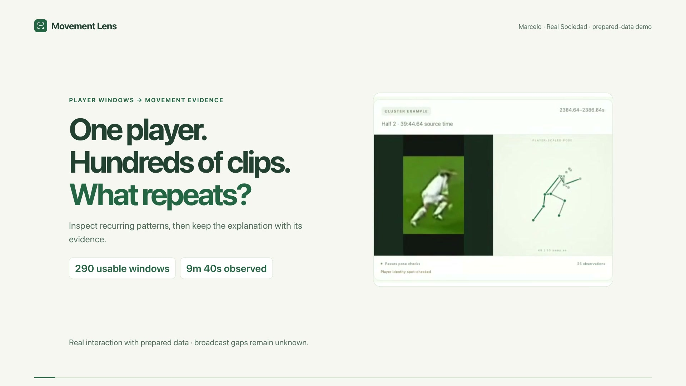
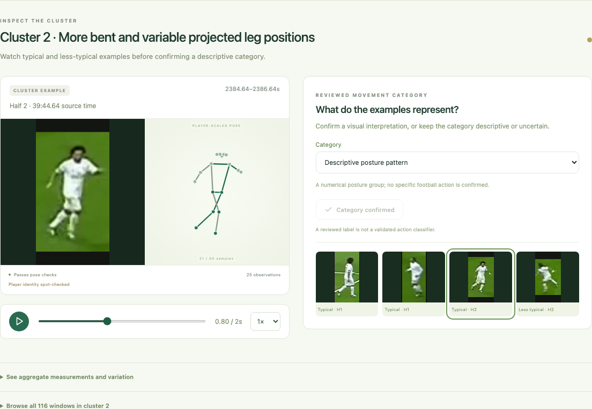
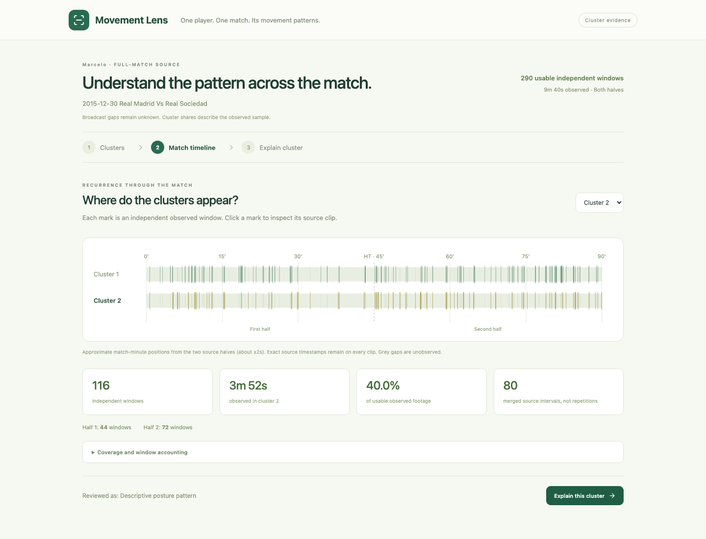
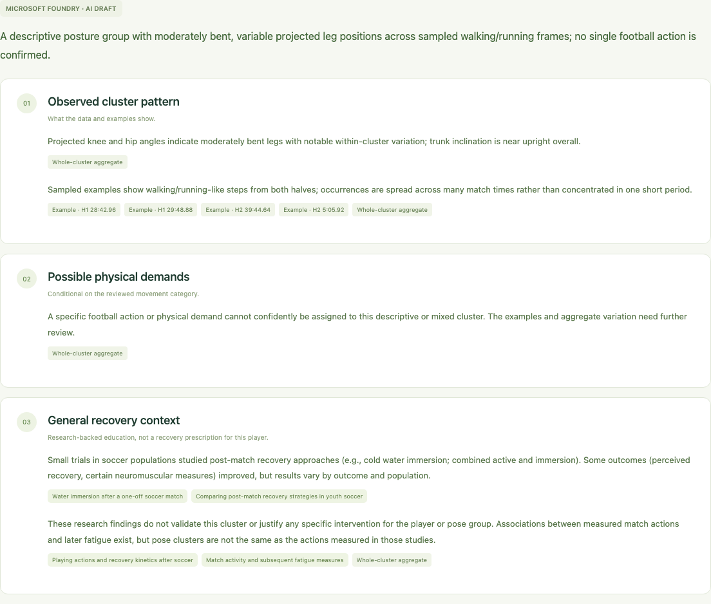
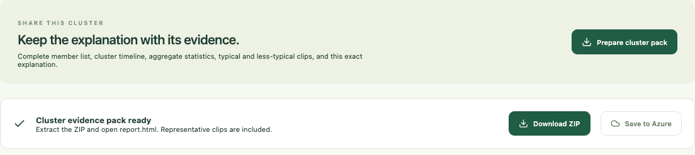

# Movement Lens

One player. One match. Its movement patterns.

[Quick start](#run-locally) · [Touchline handoff](docs/HANDOFF.md) ·
[Methods](docs/CLUSTER_MATCH_PLAN.md) · [Future work](#future-work) ·
[Microsoft integration](#optional-microsoft-integrations)

Movement Lens turns [Touchline](https://github.com/cweim/touchline) player-window datasets into inspectable movement groups, a match-wide recurrence timeline and a shareable cluster evidence pack.

**Observed movement → reviewed movement category → recurrence timeline → possible physical demands → research-backed general recovery context.**

Version 0.4 has three screens: **Clusters**, **Match timeline**, and **Explain cluster**.

[](https://github.com/cweim/movement-lens/blob/main/docs/media/movement-lens-demo.mp4)

**[Watch the 1:44 demo](https://github.com/cweim/movement-lens/blob/main/docs/media/movement-lens-demo.mp4)** ·
[Six showcase images and upload captions](docs/media/showcase/README.md)

The walkthrough connects Touchline's dataset export to cluster review, the match
timeline, a saved real Microsoft Foundry explanation and a portable evidence pack.

## Why this exists

A folder of extracted player clips is useful data, but an analyst still has to work
out which movements recur, where they appear and which examples are worth reviewing.
Movement Lens turns that library into inspectable numerical groups, source-linked
match moments and an explanation kept alongside its evidence.

## Two projects, one data flow


**[Touchline](https://github.com/cweim/touchline) prepares the dataset. Movement Lens explores it.**
The input is a **Windows** or **Both** Touchline ZIP containing pose arrays, source
timestamps and provenance, with optional player clips. Transfer the file locally
or import a private Azure snapshot. The apps run independently; no shared runtime
or live Touchline server is required.
[Follow the complete export → import walkthrough](docs/HANDOFF.md).

## Inside the app

| Inspect and review a cluster | Find its observed moments |
| --- | --- |
| <a href="docs/media/cluster-inspection.png"></a> | <a href="docs/media/match-timeline.png"></a> |
| **Explain the aggregate with citations** | **Download its evidence pack** |
| <a href="docs/media/cluster-explanation.png"></a> | <a href="docs/media/evidence-pack.png"></a> |

Screenshots show the working app and a real, previously generated Foundry draft for
the displayed cluster. [Media notes](docs/media/CREDITS.md). Original datasets and
earlier research analyses remain preserved.

## Run locally

Requires Python 3.11+, Node 20.19+/22.12+, and a Touchline export with source-bound COCO-17 pose windows. FFmpeg prepares the sampled example frames for Microsoft AI; without it the assistant receives metadata only. No tracking model or GPU is required here.

```bash
git clone https://github.com/cweim/movement-lens.git
cd movement-lens
python3 -m venv .venv
.venv/bin/python -m pip install --upgrade pip setuptools
.venv/bin/python -m pip install -e '.[test]'
cd frontend
npm ci
npm run build
cd ..
MOVEMENT_LENS_PYTHON=.venv/bin/python ./run.sh
```

Open **http://127.0.0.1:8770**. A fresh clone starts empty; import your own compatible
Touchline export using the instructions below. The private prepared example shown
in the demo is not bundled. Local grouping, review and computed explanations need
no Azure credentials; Microsoft AI and cloud storage are optional.

This loopback-only application has no multi-user authentication. Data, clips and generated reports live in ignored `runtime/`; use `MOVEMENT_LENS_STATE` for another private directory. Browsing prepared data does not need the original broadcast drive. The app never opens Touchline's live database.

The existing local workspace opens Marcelo in **Real Madrid versus Real Sociedad, December 30, 2015**, using both halves. Its audit accounts for 690 raw candidates, 403 independent candidates, 328 prepared imports and **290 usable independent windows: 580 seconds of observed movement**. There is no demo sampling cap. Sliding overlaps, identity exclusions, preparation failures and quality exclusions are accounted for separately. This is not continuous ninety-minute player observation.

## Import on a fresh installation

Export **Windows** or **Both** from Touchline, with pose arrays and optional videos. Import each half through the local API, wait for its job to complete, then reload the app:

```bash
curl -F 'file=@/absolute/path/to/first-half.zip' http://127.0.0.1:8770/api/datasets
curl http://127.0.0.1:8770/api/jobs/JOB_ID_FROM_PREVIOUS_RESPONSE
```

Repeat for the second half. Both halves must identify the same player and match; source-relative timestamps remain separate. Without a private audited match configuration, the app chooses the largest same-player match from the latest usable source snapshots. Import and Azure dataset browsing remain available through the API and local `/docs`; the primary UI stays focused on one match.

The importer requires source observations, confidence, validity masks, frame indices and interpolation flags. Each window has fifty samples at twenty-five Hz. Legacy or unverified pose-source arrays remain withheld from analysis. Source binding does not certify player identity: review provenance stays visible. Input data and media rights remain the user's responsibility.

For the existing library's completed expansion and preparation command, see [FULL_LIBRARY.md](docs/FULL_LIBRARY.md). Preparation needs the original drive; using imported snapshots does not.

## Three screens

1. **Clusters.** Robust-scale the match's projected-pose descriptors and evaluate K=2–8, subject to available distinct observations. Select the highest silhouette score; show WCSS, Davies–Bouldin and initialization agreement in a collapsed method table. Each group has three centre-nearest examples from distinct tracklets, a less-typical example, aggregate measurements and a complete paginated member browser. Inspect clips beside their player-scaled poses and confirm a descriptive category, including mixed/uncertain.
2. **Match timeline.** Every independent observed window appears in its cluster's colour. Click a mark to open its source clip. Counts, merged duration, share of usable observed footage and both-half distribution stay visible. The local demo's clock was spot-checked against the broadcast scoreboard; match-minute positions are approximate, with exact source-half timestamps retained. Blank periods are unknown.
3. **Explain cluster.** A reviewed category gates interpretation. Microsoft Foundry retrieves the complete aggregate, examples, timeline and curated primary research. Output separates observed pattern, conditional possible demands and general recovery research. Descriptive or mixed categories withhold a specific physical-demand attribution. A computed brief works without Foundry. Export freezes the explanation with its evidence and representative clips.

The current match selects **K=2: 174 and 116 windows**, with silhouette approximately 0.255. These are broad numerical posture groups, not validated football activities. Examples are selected by proximity to the cluster centre rather than demo curation. Both groups contain observations from both halves.

## What the measurements support

Projected knee/hip angles, trunk inclination and torso-scaled ankle separation remain sensitive to viewpoint, occlusion and pose errors. Usability requires source-bound provenance, valid observations, adequate required-joint coverage, no large source gaps and no large detected limb-length discontinuity. Engineering thresholds are not reliability probabilities.

Independent observations determine fitting and exposure summaries; overlapping source intervals count once toward observed duration. A window or merged interval is not a step, repetition or sprint count. Cluster frequency does not measure muscle force, activation, fatigue, injury risk, total workload or a recovery requirement. Human-reviewed categories remain interpretations.

Source video and player-scaled pose share the tracked-player crop convention. Missing joints and source-boundary clipping remain visible; original hip-centred coordinates stay in the API. Playback aligns relative time, not gait phase or camera angle.

## Future work

**The original research question was movement anomaly detection:** could a
player's pose windows reveal unusual movement relative to their usual patterns,
and eventually support investigation of changes around injury events?

Early experiments surfaced unusual windows but did not establish a consistent
pre-injury signal across matches. Sparse and uneven player coverage, noisy
broadcast poses and a limited reference library made it difficult to separate
movement changes from different activities, camera views and estimation errors.
It remains an open question whether additional data would resolve those limits.
The current app therefore focuses on an inspectable foundation: group observed
movement, review examples, locate recurrence and preserve the evidence.

Potential next steps, beyond the current single-match workflow:

- **Personal movement baselines across matches.** Collect more independent
  observations across players, matches and movement categories. Compare similar
  activities and viewpoints before treating distance from a baseline as unusual.
  Evaluate on held-out matches and players, keeping overlapping windows together
  to prevent leakage.
- **Quality-aware anomaly review.** Separate likely pose/tracking failures from
  candidate movement differences, quantify coverage and uncertainty, and ask
  analysts to review flagged clips. Measure retrieval usefulness and false-alert
  burden before considering injury-related outcomes.
- **Movement search and sequence discovery.** Use an example clip to retrieve
  comparable moments, and compare temporal pose representations with the current
  transparent descriptors. Explore transitions and longer movement sequences
  alongside the existing posture groups; validate any activity labels with human
  annotations.
- **Longitudinal movement profiles.** Compare a player's reviewed patterns across
  matches or match periods, accounting for observed coverage, activity mix and
  camera view. Link source-timed windows to permitted event or tracking data to
  investigate the football context in which a pattern appears.
- **Validate against better measurements.** Where paired data and consent are
  available, compare broadcast-derived measurements with multi-view video,
  motion capture or wearables. Study whether viewpoint correction or 3D pose
  improves measurement reliability before making biomechanical interpretations.

**A longer-term goal is to support coaching and physio review with validated
longitudinal evidence.** Injury prediction or individualized recovery support
would additionally require appropriate outcome data, prospective evaluation and
clinical collaboration. Larger pose datasets alone would not validate those
claims. The next practical milestone is a broader, independently reviewed
Touchline window library and a benchmark for finding comparable movements.

## Evidence pack

The ZIP includes `report.html`, `report.json`, `provenance.json`, `cluster-members.csv`, `aggregate-features.csv`, `k-diagnostics.csv`, `timeline.json`, and typical/less-typical example MP4s when available. An audited workspace also includes `candidate-audit.json`. All member records are included; only representative videos are bundled.

Extract the ZIP and open `report.html` independently of the app. Saved explanations are bound to the match/model, K, complete cluster assignments, reviewed category and research version. Changing selections clears the draft; export rejects stale explanations. Previously generated reviews remain preserved.

## Optional Microsoft integrations

No service is provisioned automatically. Credentials stay in backend environment variables. Local grouping, playback, timeline and computed reports work without Azure.

### Microsoft Foundry

```bash
.venv/bin/python -m pip install -e '.[foundry]'
az login
export MOVEMENT_LENS_FOUNDRY_PROJECT_ENDPOINT='https://YOURRESOURCE.services.ai.azure.com/api/projects/YOURPROJECT'
export MOVEMENT_LENS_FOUNDRY_MODEL='YOUR-DEPLOYMENT-NAME'
MOVEMENT_LENS_PYTHON=.venv/bin/python ./run.sh
```

**Explain with Microsoft AI** sends the selected cluster's aggregate and timeline through a bounded, read-only Responses function-tool loop. With FFmpeg and included clips, it also sends up to four JPEG strips, each containing three sampled frames from a typical or less-typical example. Full videos are not sent. Without images, the assistant receives example metadata and must not claim visual inspection. Use a deployment supporting Responses, tools, strict structured output and image input for the multimodal path.

All four evidence tools must run before the final explanation. Citation choices are limited to retrieved IDs; returned citations are validated and prose is checked for unsupported quantities or individualized recovery advice. Exact measurements remain deterministic. General recovery context cites primary studies and their limitations; it does not prescribe treatment, recovery duration or a player-specific intervention. Primary studies are curated in `cluster_research.py`.

Inference can incur charges. Saved real cluster explanations have been generated with the configured Foundry deployment, four example-image strips and all four evidence tools. The screenshots display one of those immutable results; no new model request was made to capture them. Controlled adapter tests and live results are distinct evidence. See [VERIFICATION.md](docs/VERIFICATION.md).

Microsoft documentation: [SDK and project endpoints](https://learn.microsoft.com/en-us/azure/foundry/how-to/develop/sdk-overview), [structured outputs](https://learn.microsoft.com/en-us/azure/foundry/openai/how-to/structured-outputs).

### Private Azure report storage

```bash
.venv/bin/python -m pip install -e '.[azure]'
az login
export MOVEMENT_LENS_AZURE_ACCOUNT_URL='https://YOURACCOUNT.blob.core.windows.net'
export MOVEMENT_LENS_AZURE_CONTAINER='YOUR-PRIVATE-CONTAINER'
MOVEMENT_LENS_PYTHON=.venv/bin/python ./run.sh
```

After preparing a pack, **Save to Azure** uploads an immutable content-addressed ZIP to an existing private container. **Download from Azure** verifies its SHA-256. Use an identity with suitable blob permissions. Storage and transfer can incur charges. The adapter has mocked upload/download and checksum coverage; this build does not claim a live Movement Lens report round trip.

### Azure Touchline snapshots

Set `MOVEMENT_LENS_AZURE_SOURCE_ACCOUNT_URL` and `MOVEMENT_LENS_AZURE_SOURCE_CONTAINER`. The API lists snapshots at `/api/azure/datasets` and imports through `/api/azure/datasets/import`. It pins ETags, bounds downloads, verifies hashes and reuses the local importer; cloud origin does not bypass quality gates. The source container can differ from the report destination. See local `/docs` for request fields.

## Verify and repository boundary

```bash
.venv/bin/python -m pip install -e '.[test,azure,foundry]'
.venv/bin/python -m pytest -q
cd frontend
npm run build
```

See [the implemented cluster specification](docs/CLUSTER_MATCH_PLAN.md) and [verification evidence](docs/VERIFICATION.md). Earlier product plans describe historical interfaces.

Commit source, tests, dependency manifests, docs and the selected presentation assets in `docs/media/`. Keep `runtime/`, `.venv/`, `.env`, source video, model weights and private outputs out of Git. This standalone folder is separate from the submitted Touchline app. See [publishing notes](docs/PUBLISHING.md) and [third-party notices](THIRD_PARTY_NOTICES.md). A license for the original application code has not yet been selected.

Architecture: `importer.py` validates snapshots; `features.py` computes descriptors and quality; `exploration.py` supplies the numerical catalogue; `clusters.py` builds single-match aggregates, review gates and exports; `cluster_ai.py` orchestrates evidence tools; `cluster_research.py` holds primary research; `pose_view.py` controls display framing; `cloud.py` owns report storage; `azure_datasets.py` imports snapshots; `app.py` exposes the local API; `frontend/` provides the three screens. Older novelty/review APIs remain for reproducibility.
