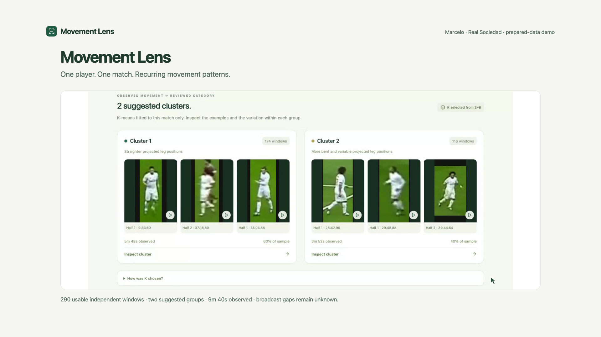
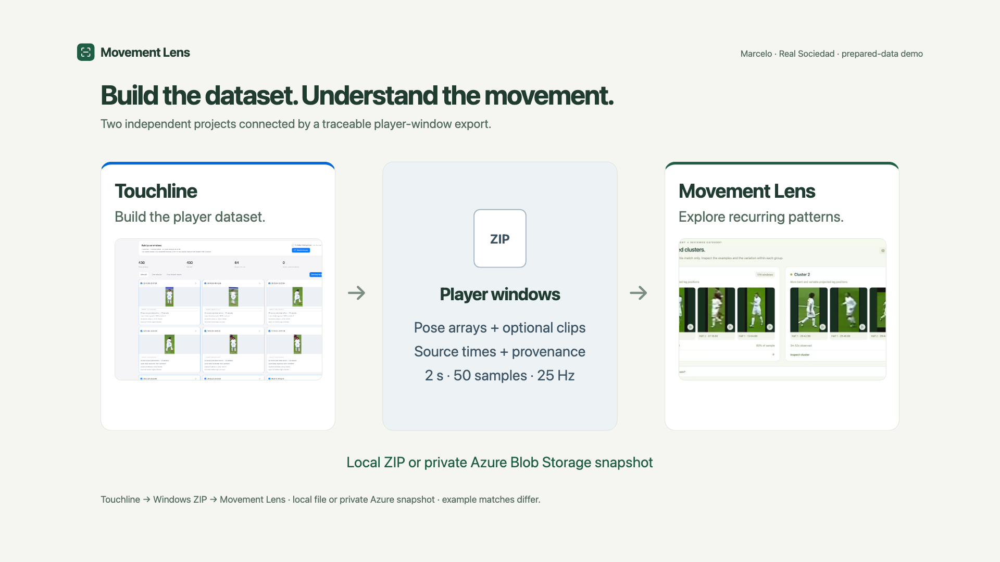
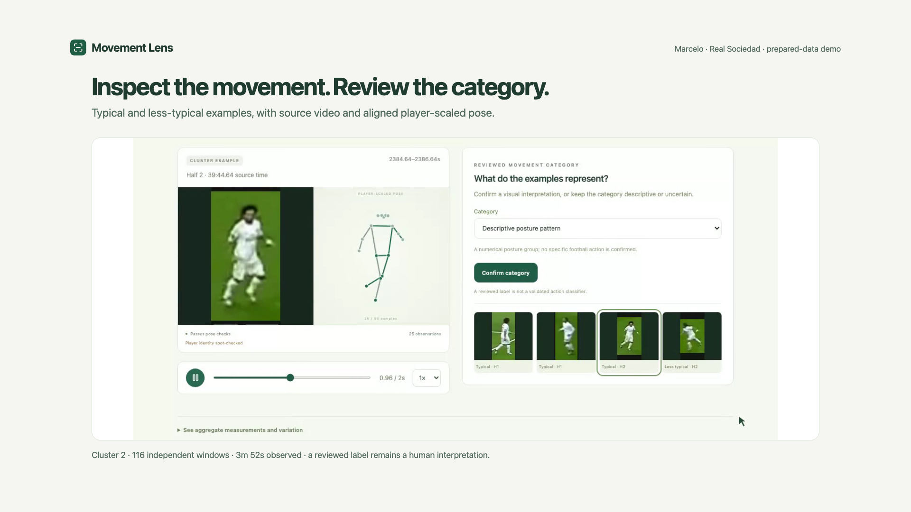
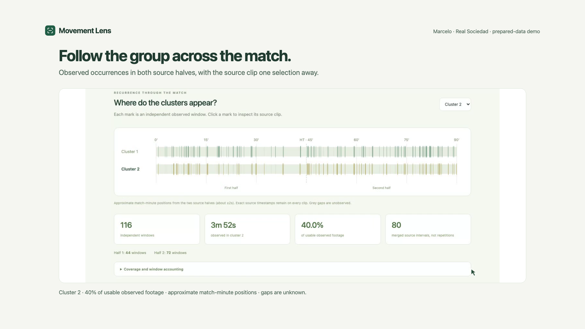
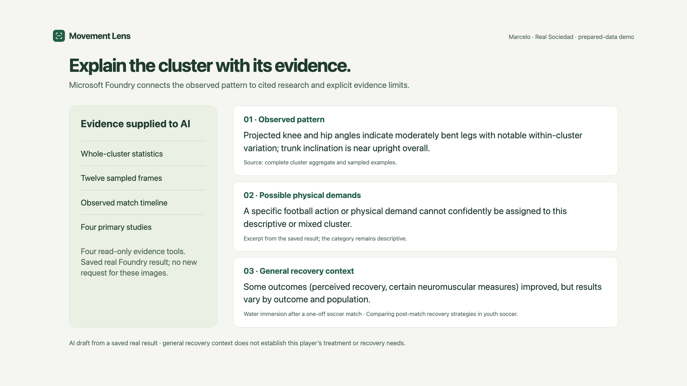
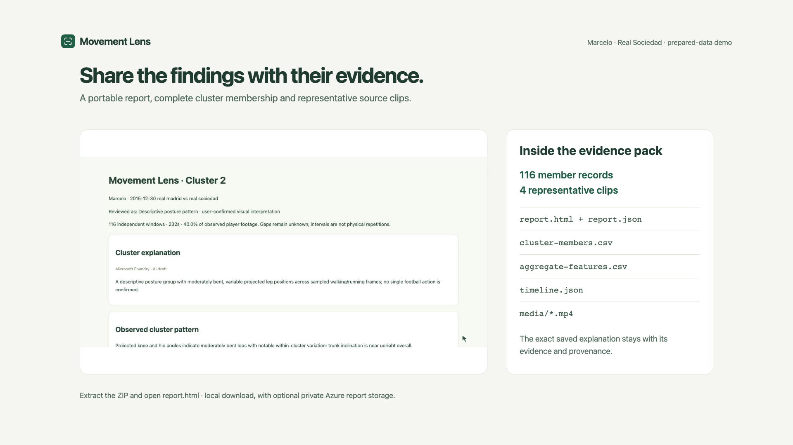

# Movement Lens showcase stills

Six **1920×1080 PNGs** for the GitHub README and hackathon media gallery. These are designed presentation cards using actual app captures, original schematic graphics and a real saved Microsoft Foundry result. The app itself is unchanged. Raw app screenshots remain in the parent media directory.

Recommended gallery order follows the numbered filenames.

## Movement Lens

One player. One match. Recurring movement patterns.

## Build the dataset. Understand the movement.

Two independent projects connected by a traceable player-window export.

## Inspect the movement. Review the category.

Typical and less-typical examples, with source video and aligned player-scaled pose.

## Follow the group across the match.

Observed occurrences in both source halves, with the source clip one selection away.

## Explain the cluster with its evidence.

Microsoft Foundry connects the observed pattern to cited research and explicit evidence limits.

## Share the findings with their evidence.

A portable report, complete cluster membership and representative source clips.

## Media provenance

The example is Marcelo in Real Madrid versus Real Sociedad: 290 usable independent windows and 580 observed seconds. The selected cluster has 116 members. The Touchline card illustrates the export contract with its older saved match, rather than claiming a recorded same-archive transfer.

The AI card quotes a real saved result bound to the displayed cluster/category. Its original request used four three-frame image strips and the aggregate/timeline/research tools; no new model request was made to capture the media. Source observations, possible demands and general recovery context remain distinct. The evidence card shows an actual portable report with all cluster members and representative clips.

Football imagery remains third-party material. The pipeline graphics and presentation layout are original. See [media credits](../CREDITS.md). Video music is not part of the PNGs.
